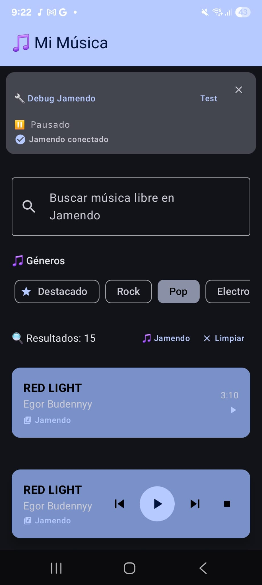
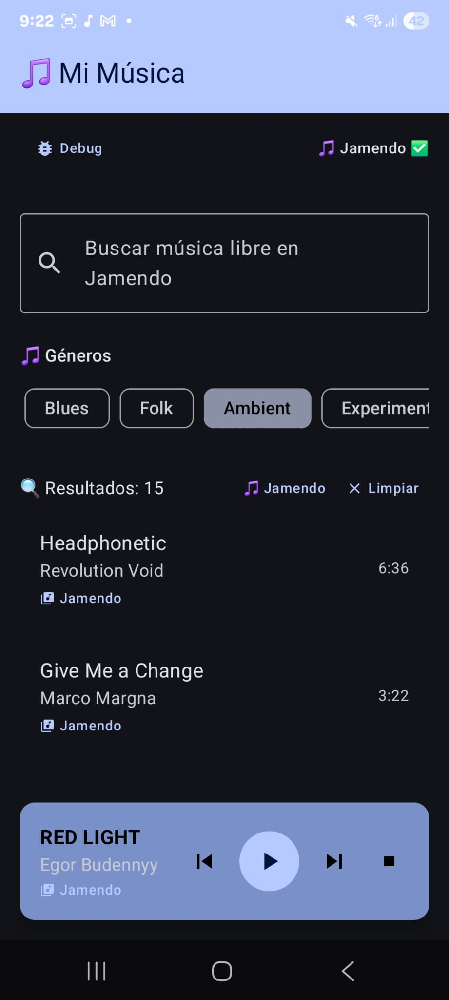

# 🎵 Reproductor Multimedia Android

[](https://android.com/)
[](https://kotlinlang.org/)
[](LICENSE)

## 📖 Descripción

Reproductor multimedia moderno y personalizable para Android. Reproduce los archivos de audio del dispositivo y música en streaming desde **Jamendo**, plataforma de música independiente, a través de su API. Este proyecto forma parte de mi portafolio de desarrollo móvil.

**Motivación**: quería tener control sobre mi propia experiencia musical, sin depender de las limitaciones de las plataformas de streaming tradicionales. El objetivo del proyecto es que la **fuente de música sea intercambiable**: hoy funciona con Jamendo y con archivos locales, y está pensado para poder conectarse en el futuro a otros servicios o a un servidor multimedia propio.

## ✨ Características Principales

- 🎶 **Reproducción local y en streaming**: archivos del dispositivo y música de Jamendo mediante su API [indica qué permite: buscar, explorar por género, popularidad…]
- 🎨 **Interfaz moderna**: Material Design 3 con tema claro y oscuro
- 📱 **Gestión avanzada**: creación y administración de playlists personalizadas
- 🔄 **Modos de reproducción**: normal, aleatorio y repetición por canción o playlist
- 🔔 **Control en segundo plano**: notificaciones interactivas y widget en la pantalla de inicio
- 🎵 **Soporte multi-formato**: MP3, FLAC, OGG, WAV y más formatos de audio
- 📊 **Visualizador de audio**: efectos visuales durante la reproducción

## 🛠️ Tecnologías Utilizadas

### Desarrollo Android
- **Kotlin 100%**: lenguaje principal
- **Android SDK**: framework de desarrollo nativo
- **Gradle**: construcción y gestión de dependencias

### Arquitectura y Componentes Android
- **Activities & Fragments**: interfaz de usuario
- **Services**: reproducción en segundo plano
- **MediaPlayer API**: motor de reproducción de audio
- **ContentResolver**: acceso a los archivos multimedia del dispositivo
- **Notifications**: control de reproducción desde la barra de notificaciones

### Red y servicios externos
- **API REST de Jamendo**: catálogo de música en streaming [+ librería de red que uses: Retrofit, OkHttp…]

### Gestión de Datos
- **SharedPreferences**: configuración y preferencias del usuario
- **External Storage API**: acceso a archivos de audio locales

### Herramientas de Desarrollo
- **Android Studio**, **Gradle**, **Git**

## 📱 Capturas de Pantalla



*Biblioteca de música y navegación*



*Interfaz principal con biblioteca de música y navegación*

## 🚀 Instalación y Configuración

### Prerrequisitos
- Android Studio Flamingo (2022.2.1) o superior
- Android SDK nivel 24 (Android 7.0) o superior
- Dispositivo o emulador con API 24+ y conexión a internet (para el streaming)
- Una clave de desarrollador de Jamendo (`client_id`), ver [Configuración de Jamendo](#-configuración-de-jamendo)

### Pasos de Instalación

1. **Clonar el repositorio**
```bash
git clone https://github.com/Yucsan/android_musica.git
cd android_musica
```

2. **Abrir en Android Studio**: "Open an Existing Project" y seleccionar la carpeta `android_musica`.

3. **Configurar la clave de Jamendo** (ver sección siguiente).

4. **Sincronizar dependencias**
```bash
# Android Studio sincroniza automáticamente, o ejecuta:
./gradlew clean build
```

5. **Ejecutar la aplicación**: con un dispositivo o emulador conectado, pulsa "Run" o ejecuta:
```bash
./gradlew installDebug
```

## 🔑 Configuración de Jamendo

El streaming usa la API de Jamendo, que requiere una clave propia (`client_id`). Se obtiene registrando una aplicación en el portal de desarrolladores de Jamendo. [Indica dónde se coloca: `local.properties`, `BuildConfig` o variables]. No subas tu clave al repositorio.

## 🏗️ Estructura del Proyecto

```
android_musica/
├── app/                       # Código principal de la aplicación
│   ├── src/main/
│   │   ├── java/com/yucsan/musica2/
│   │   │   └── servicio/      # JamendoService: acceso a la API de Jamendo
│   │   ├── res/               # Layouts, valores, drawables e iconos
│   │   └── AndroidManifest.xml
│   └── build.gradle           # Configuración de la aplicación
├── gradle/                    # Configuración del sistema Gradle
├── imagenes/                  # Capturas de pantalla
├── build.gradle               # Configuración del proyecto
├── settings.gradle.kts        # Configuración de módulos
└── README.md
```

## 📈 Roadmap y Características Futuras

- [x] **Streaming desde Jamendo**: reproducción de música en línea mediante su API
- [ ] **Fuentes de música intercambiables**: interfaz común para poder cambiar de servicio (Jamendo, servidor propio u otros)
- [ ] **Servidor multimedia propio**: conexión a un backend personal como fuente adicional
- [ ] **Sincronización multi-dispositivo**: playlists y progreso compartido
- [ ] **Recomendaciones**: basadas en preferencias musicales
- [ ] **Integración con Last.fm**: scrobbling automático
- [ ] **Ecualizador avanzado**: control detallado del audio
- [ ] **Descarga offline**: caché local de canciones

## 🤝 Contribuciones

Este proyecto es parte de mi portafolio personal, pero estoy abierto a sugerencias y mejoras. Si encuentras algún bug o tienes ideas:

1. Fork del repositorio
2. Crear una rama (`git checkout -b feature/nueva-caracteristica`)
3. Commit de los cambios (`git commit -am 'Añadir nueva característica'`)
4. Push a la rama (`git push origin feature/nueva-caracteristica`)
5. Crear un Pull Request

## 📄 Licencia

Proyecto bajo licencia MIT. Consulta el archivo [LICENSE](LICENSE) para más detalles.

## 👨‍💻 Autor

**Yucsan**
- GitHub: [@Yucsan](https://github.com/Yucsan)

## 🙏 Agradecimientos

- Comunidad de Android Developers
- [Jamendo](https://www.jamendo.com) por su API y su catálogo de música
- Inspiración en reproductores como VLC y PlayerPro
